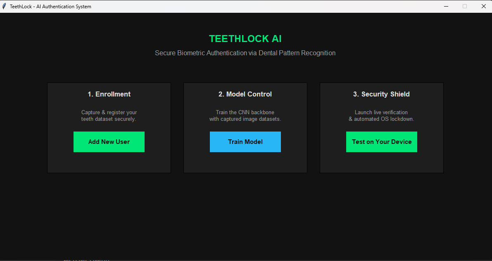
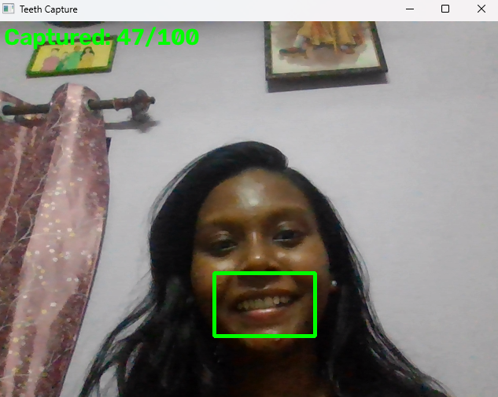
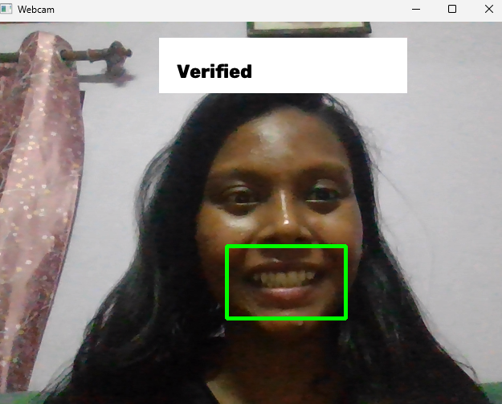
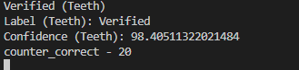

🦷 TeethLock – AI-Based Laptop Authentication using Teeth Recognition

📌 Overview

TeethLock is an AI-powered authentication system that verifies a user's identity using teeth biometrics captured through a webcam.

Unlike traditional face recognition systems, TeethLock authenticates users based on the unique characteristics of their teeth, providing an additional biometric security layer and automated OS-level threat response (Win + L screen lock).

The project was developed as a Bachelor of Engineering Final Year Project.

✨ Features

User registration through webcam with a modern dark-themed GUI

Automatic teeth dataset collection (100 Region of Interest frames per user)

Facial landmark detection using dlib & Haar Cascades

CNN-based teeth recognition model (built with TensorFlow/Keras)

Model training using transfer learning

Real-time biometric authentication testing

Automated Windows security lockdown (Win + L) on authentication failure

Fully styled dark-mode Tkinter interface with custom-themed dialog boxes

🏗 Project Architecture

Camera
   │
   ▼
Face Detection (OpenCV)
   │
   ▼
68 Facial Landmarks (dlib)
   │
   ▼
Teeth Region Extraction
   │
   ▼
CNN Model (TensorFlow/Keras)
   │
   ▼
Authentication
        ├── Verified ✅ -> Access Granted
        └── Stranger ❌ -> Lock Computer (Win + L)

📂 Project Structure

TeethLock/
│
├── assets/
│   ├── gifs/
│   └── screenshots/
│
├── dataset/
│
├── docs/
│
├── models/
│   ├── base_model.h5
│   ├── haarcascade_frontalface_default.xml
│   └── shape_predictor_68_face_landmarks.dat
│
├── src/
│   ├── app_gui.py
│   ├── create_face_datasets.py
│   ├── training_model.py
│   └── lock_unlock_face_recognition.py
│
├── trainer/
│   └── trained_model.h5
│
├── requirements.txt
├── LICENSE
└── README.md

⚙ Technologies Used

Python (3.14)

TensorFlow / Keras

OpenCV

dlib

Pillow (PIL)

NumPy

Tkinter (Custom Dark UI)

PyAutoGUI

🚀 Installation

Clone the repository.

git clone https://github.com/yourusername/TeethLock.git

Move into the project.

cd TeethLock

Install dependencies.

pip install -r requirements.txt

▶ Running the Project

Start the application.

python src/app_gui.py

📷 Workflow

1. Register User

Capture 100 images of the user's teeth.

2. Train Model

Train the CNN model using the captured dataset.

3. Authenticate

Run the authentication module to verify the user.

🎥 Live Demo & Screenshots

End-to-End Walkthrough

TEETHLOCKD/assets/video/Teeth-authentication.gif

Home Screen

Dataset Collection

Training

Authentication

📚 Academic Publication

This project serves as the practical implementation of our research work in biometric security and computer vision. If you use or reference this work in your research, please cite our publication:

> **Securing Smartphone User Authentication Using Teeth Pattern**  
> * **Authors:** Sushil Mhetre, Shashikant V. Athawale, Latika Kumare, Sanket Lipne, and Sumeet Koli  
> * **Journal:** *International Journal of Applied Engineering & Technology*, Vol. 5, No. 4, December 2023  
> * **ISSN:** 2633-4828
> * [\[Link to Paper\]](assets/research_paper/ijaet20v5-4-2023-213.pdf)

👩‍💻 Author

This repository is maintained by Latika Kumare.

Originally developed as a Bachelor of Engineering Final Year Group Project.

Team Members -

*Latika Kumare

*Sushil Mhetre

*Sanket Lipne

*Sumit Koli

👩‍💻 Maintainer

This repository is maintained and enhanced by Latika Kumare.

The original system was developed as a Bachelor of Engineering Final Year Group Project.

📄 License

This project is licensed under the MIT License.